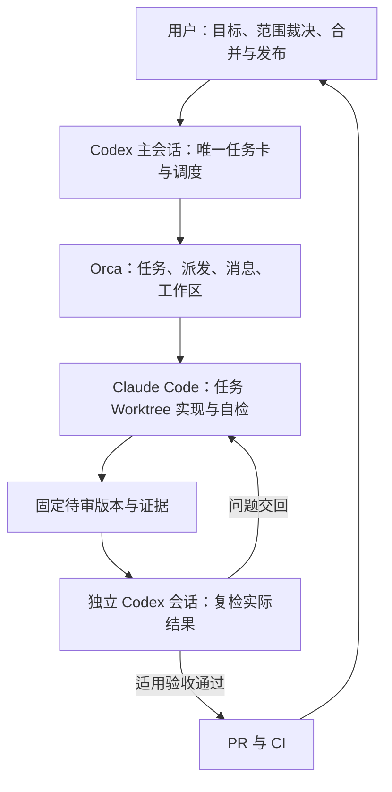

# Orca 中以 Codex 协调、Claude Code 实施的开发方案

> 调研日期：2026-10-08。状态：**调研方案，待试运行，未生效为项目规则**。
> 本次授权仅为调研和保存文档；未创建 Run、Worker、Worktree 或 PR，未开启 Experimental，未更改权限、CI 或分支保护。
> 用户明确要求保存在 `docs/`，因此本方案放在此处；具体私有任务、运行日志与研究案例仍按现有约定留在本机。本文不包含私有研究数据或凭据，也不构成新增默认 Agent 步骤的授权。

## 1. 结论与适用范围

方案技术上可行。建议以 Orca 提供执行与可视化环境，Codex 主会话负责调查、任务约束、调度和证据汇总，Claude Code 负责任务 Worktree 内的实现与自检，独立 Codex 会话负责复检，用户保留目标、范围变化、合并和发布裁决。

先串行跑通一个真实任务，再考虑两个独立任务并行。不新增公开 Skill、CLI 一级命令、报告栏目或常驻 Agent；不把 Orca 写入共享引擎依赖。现有 [AGENTS.md](../AGENTS.md)、[CLAUDE.md](../CLAUDE.md) 与 [开发执行与验收流程](development-workflow.md) 保持规范权威，本文只讨论如何用工具承载这些职责。

能力成立不等于闭环已验收：当前证据支持“环境存在、运行时可连接、命令和协议可用”，尚不支持“自动派发、恢复、独立复检、PR/CI 全链已成功”。

## 2. 调研证据与边界

### 2.1 官方资料

| 来源 | 本次确认的事实 | 对方案的意义 |
|---|---|---|
| [Orca 入门](https://www.onorca.dev/docs/first-session) | 支持按任务创建 Git Worktree，启动 Claude Code、Codex，查看与批注 Diff | 可以承载隔离实施和反馈 |
| [Orca Orchestration](https://www.onorca.dev/docs/cli/orchestration) | 提供 Run、Task、Dispatch、受监督 Worker、消息与 Gate；文档标为 Experimental | 主从协作需显式配置与验证，不能仅打开两个终端 |
| [Orca CLI 指南](https://github.com/stablyai/orca/blob/main/skill-guides/orca-cli.md) | 区分一次性终端输入、完全移交与受监督编排；输入接收不证明任务已开始 | 本方案选受监督编排，避免把派发成功当完成 |
| [Orca Hooks 与 Memory](https://www.onorca.dev/docs/agents/hooks-memory) | 使用 Agent 原有配置和记忆文件，并支持 Worktree setup hook | 可以复用现有规范；需检查实际启动配置 |
| [OpenAI Docs：非交互模式](https://learn.chatgpt.com/docs/non-interactive-mode) | `codex exec` 支持脚本调用、JSONL 事件及结构化输出 | 若改用脚本调度可作为备选，本版不建设第二套调度器 |
| [Claude Code 权限](https://code.claude.com/docs/en/permissions) | 提示词不改变实际工具权限；权限由运行时规则、模式及策略控制 | “只写任务目录”需另行验权限，不能靠角色称谓保证 |
| [Claude Code 程序化调用](https://code.claude.com/docs/en/headless) | 支持程序化运行 | 可作为 Orca 不适用时的后续评估路线，本版不实施 |
| [Git Worktree](https://git-scm.com/docs/git-worktree) | 同仓库支持多个检出目录；部分 Git 管理信息共享；支持正常移除与失效记录清理 | 隔离检出目录不能隔离全部进程和外部状态 |
| [GitHub 分支保护](https://docs.github.com/en/repositories/configuring-branches-and-merges-in-your-repository/managing-protected-branches/about-protected-branches) | 可要求 PR、审核和状态检查；存在适用权限与绕过设置 | 必须检查实际仓库设置，不把方案文字当强制保护 |

资料反映调研时状态；命令以安装版本的帮助和随版本指南为准。本次首次读取 Orchestration 网页成功，后续一次重取失败；协议细节另以本机指南交叉核对。

### 2.2 本机只读核查

| 检查 | 2026-10-08 观察结果 | 证据性质 |
|---|---|---|
| `command -v orca` / `ORCA` / `codex` / `claude` | 四个命令均可找到 | 安装存在；不证明登录、额度或启动成功 |
| `orca status --json` | `ok=true`，app running，runtime ready / reachable，版本 1.4.222 | 当前运行时可连接 |
| `codex --version` | codex-cli 0.161.0 | 版本观察 |
| `claude --version` | Claude Code 2.1.291 | 版本观察 |
| `orca --help` 与 `orca orchestration worker-start --help` | 有任务、派发、消息、Gate、受监督 Worker 和显式工作区参数 | 命令面存在；未创建任何执行对象 |
| `orca skills get orchestration --full` | 成功读取随版本指南 | 核对协议；读取不等于安装或启用工作流 |
| 同指南的 `messaging-and-gates.md` / `placement-and-remote.md` | 成功读取 | 核对消息、Gate、工作区与恢复边界 |

仓库核查基线为 `a869f5172f74cbd65bf581857406f1768bab230b`，所在分支 `feat/v0.3.2`；`pyproject.toml` canonical version 为 `0.3.1`。工作区有大量已暂存及未暂存修改。本文引用的代码观察来自**该提交加当时工作区内容**，不是该提交单独的实现承诺，也不能据分支名判定版本已完成。调研没有运行测试、真实联网采集或研究库写入。

## 3. 对原方案的调整

| 原提议 | 本项目建议 | 依据 |
|---|---|---|
| 每个任务都等待 Scope、Plan 人工批准 | 低影响任务合并阶段，按已有授权执行；改变目标或触发扩张门禁时请求裁决 | [开发流程 §2、G1](development-workflow.md) |
| 最多两轮返工，之后固定停止 | 两轮同类失败作为根因复盘节点；不作为默认停止规则或完成依据 | 开发流程 G4 无固定审核轮数 |
| Planner、Verifier、Reviewer 全部常驻 | 一个协调会话、一个实施会话、按需独立复检会话 | 现有流程按职责分工，不要求新增常驻 Agent |
| 全仓统一前端检查清单 | 复用 Python 项目检查，按变更风险增加真实入口及产物验收 | `pyproject.toml`、现有 CI、开发流程 G2–G5 |
| 默认从最新 `origin/main` 开始 | 从明确裁决的完整基线开始，必要时依赖版本分支；记录准确 SHA | 当前主线含未提交版本工作，直接从 main 可能遗漏必要依赖 |
| 通用 `fix/T-*` 分支命名 | 首轮保留现有 `feat/v{version}` 主线约定；任务分支命名在试运行前明确，不能静默重写规范 | [CLAUDE.md 版本规则](../CLAUDE.md) |
| Agent done / CI 绿即交付完成 | 分开记录执行结束、独立复检、工作包验收、版本目标验收与发布授权 | 开发流程完成门禁 |

保留原方案中“一任务一个主要写入者”“明确验收与反例”“人工合并”“先串行后并行”的思路。一个实施者可以同时改代码和相关测试；只有测试工作与实现契约、文件及运行资源真正独立时才拆为并行任务。

## 4. 推荐架构与权责



| 角色 | 允许的工作 | 约束 |
|---|---|---|
| 用户 | 裁决目标和范围变化，授权合并与发布 | 自然人反馈未发生不得由 Agent 代签 |
| Codex 协调者 | 搜索调查、维护主表、创建授权任务、回复范围内问题、路由返工、汇总证据 | 不改业务实现；不替用户批准范围扩张；不自行解决人工 Gate |
| Claude Code 实施者 | 在任务工作区复现、最小修改、D11 检查、自检，按授权提交 | 不扩范围、不降低验收、不改主线、不自行合并发布 |
| 独立 Codex 复检者 | 独立读取原任务和待审版本，执行关键反例、真实出口及风险核验 | 不复用协调者原会话充当独立上下文；不静默修复后自行签认 |
| CI | 执行仓库现有确定性检查并保留记录 | 不替代财务含义、报告逻辑及版本目标验收 |

“只读”指不修改被审业务实现，验证可以在独立临时位置生成日志和产物。实际权限尚未配置验证，不宣称角色表已经形成技术隔离。首轮不默认使用绕过权限模式，不复制凭据文件到任务材料，不修改 `$HOME` 等系统变量来伪造隔离。

## 5. 任务卡与证据交接

复用 [开发流程 §4](development-workflow.md) 的唯一任务主表，不在 Orca、PR、不同模型会话各维护一份竞争计划。Orca 记录执行状态；主表记录目标、裁决和验收；Git 记录实现版本；CI/日志记录检查结果。

在现有主表上补充以下工具交接字段即可：

```markdown
任务 ID：
原始请求／唯一生效计划：
基线 SHA／纳入的原有未提交改动及其记录：
实施 Worktree 完整地址／当前分支／唯一写入者：
可改文件、共享契约与禁止写入位置：
运行时写入目录／数据库／缓存／联网预算：
Run ID／Task ID／当前 Dispatch ID：
待审提交 SHA／产物哈希：
授权范围／需人工裁决事项／明确授权记录：
回退方式：

| 验收 ID | 用户可观察结果 | 正例与反例 | 实际入口 | 证据 | 状态 |
|---|---|---|---|---|---|

实施自检：命令、退出码、环境、输入、产物、D11 命中处置。
独立复检：实际版本、自行执行项、复用证据、发现与未验证项。
结项：工作包结论、版本目标状态、合并／发布授权状态。
```

具体任务主表建议留在既有 `host-docs/` 任务目录，实施者通过任务 brief 得到必要约束和证据位置；新 Worktree 不会自动携带主工作区未跟踪文件，交接时必须显式提供可访问副本或完整摘要。复检会话先读原任务、标准、实际代码和产物，再读实施者结论。

验证开始前固定提交或可复核的工作区快照；复检期间暂停该任务的业务写入。返工后签认新版本，不能沿用旧版本的 PASS。日志记录命令、退出码、时间、执行目录、工具版本与输入，不输出 token 或完整环境变量。

## 6. Worktree、外部状态与并行边界

### 6.1 先固定完整基线

现有未提交改动不自动 stash、提交、丢弃或带入新任务。试运行前列明选中任务依赖的修改，选择已提交基线或经明确确认的快照；冻结证据后再创建工作区。依赖版本工作的任务不能误从旧 main 开始，独立任务也不能误继承未完成的版本改动。

由 Orca 管理的任务优先使用 Orca 创建和移除；已用 Git 创建的外部 Worktree 需验证 Orca 的登记与可见性。创建后核对完整工作区地址、实际 Git 分支、HEAD 和父基线；Orca 界面分组或 parent lineage 不代替 Git 依赖关系。正常清理不使用强制删除，先保存证据并确认无未提交工作；`prune` 只用于检查确认后的失效管理记录。[Git Worktree 文档](https://git-scm.com/docs/git-worktree)

### 6.2 本项目已发现的共享状态

当前 [共享配置层](../skills/lib/env.py) 将 `STORE_DB` 默认指向用户级 `~/.local/share/investment/research.db`，并读取全局配置；[研究库](../skills/invest-a-stock/scripts/lib/store.py) 通过 `get_db_path()` 解析路径，现有 `_db_override` 是测试内部隔离机制。**没有在本次调研中证实通用 CLI 已提供任务级研究库覆盖入口**，不得凭空写出环境变量方案。

因此，独立 Worktree 不保证数据库隔离。WAL 并发也不解决不同实现同时迁移、不同测试污染记录或业务语义冲突。首轮选用已有临时库 fixture 的测试路径；需要真实数据库写入的验收，必须先证明既有入口可安全隔离，否则作为该路径的阻塞项，单独提出最小方案。不得直接试写个人研究库。

每个任务还需核对报告输出、共享缓存、`.venv`、端口、凭据读取及数据源额度。使用既有可配置入口隔离；缺少入口时记录限制，不能以“Worktree 已隔离”放行。

### 6.3 并行条件

首轮只有一个写入任务。后续只有代码文件、契约和外部写入资源均无冲突时才启动两个任务并行。共享财务口径、QC、存储、迁移、版本文件、锁文件与分发构建先串行。代码实现与只读调查可按需并行，但本方案不自动启动额外 Agent。

## 7. Orca 编排路径与故障处理

建议把 Codex 协调者运行在 Orca 管理的明确工作区终端中，以便稳定绑定身份和 Run；外部 Codex 会话作为协调者的身份绑定尚未实测。未来试运行前读取 `orca skills get orchestration --full` 及所需参考，确认 Experimental 设置、工作区和权限。本节命令只为评估示意，**本次未执行创建命令**。

```bash
# 只读前置核查
orca status --json
orca skills get orchestration --full
orca orchestration worker-start --help

# 以下仅在另行授权试运行并固定基线后使用；占位符须替换
orca orchestration run-create --objective '<任务目标>' --json
orca orchestration task-create --spec '<自包含任务约束与验收>' --task-title '<任务标题>' --json
orca orchestration worker-start --task '<返回的 task_id>' \
  --worktree new-top-level --repo '<已发现的仓库选择器>' \
  --base-branch '<已确认的基线 SHA>' --name '<任务名>' \
  --agent claude --setup skip --json
```

这里的 `--setup skip` 仅适用于先排除未审查自动 hook、随后显式准备依赖的首轮试验；若依赖审查过的 setup hook，应选择 `run` 并确认完成后才开始任务。不能把“Agent 已打开”当环境已准备好。模型沿用用户配置，不在本方案指定品牌内部型号或强度。

正常交接为：派发 → 实施者按注入的协议回报 → 协调者校验当前尝试并处理消息 → 安排独立复检 → 将发现交回原实施者 → 汇总交付。不要自行拼造 Worker 的生命周期 ID 或 completion 命令；使用实际注入 preamble。[Orca CLI 指南](https://github.com/stablyai/orca/blob/main/skill-guides/orca-cli.md)

本机随版本指南额外确认：Task/Dispatch 标识约束执行尝试；消息成功入队不证明读取；协调者需处理 Delivery 全部消息后确认；执行结算后需决定复用、保留或释放资源。以下故障策略属于本项目试运行设计，需逐项实测：

| 情况 | 处理要求与应拦截反例 |
|---|---|
| 输入已接收但开始状态不明确 | 查询状态与回执，不因沉默再次派发同一写入任务 |
| Worker 等待权限或范围问题 | 范围内问题由协调者处理；人工事项保留待决，不能由协调者代批准 |
| 等待超时或连接中断 | 标为未知／未验证，检查存活状态；不据此判死或启动第二个写入者 |
| 收到旧尝试完成消息 | 对照活动 Task/Dispatch，不用于当前尝试签认 |
| Worker 自报成功 | 仅进入自检结束／待独立复检，不能直接触发 Merge |
| 独立复检后发生改动 | 使受影响签认失效，绑定新版本复验 |
| 释放或停止结果不明确 | 遵循当前版本恢复回执，保留工作；不以广泛关闭终端替代精确清理 |
| 同类失败重复两轮 | 复盘根因和验收假设，继续可修工作；需要改范围时交用户裁决 |

Orca Gate 是协调者管理的任务决策机制。要称为人工批准，必须另存真实用户决定及适用范围；不允许“协调者 resolve 了 Gate”冒充用户批准。运行状态 completed、界面 done 和 GitHub 检查通过也不等于项目验收通过。

## 8. 验证与交付门禁

不在本次新建 `scripts/verify.sh`。当前 [Validate CI](../.github/workflows/validate.yml) 已运行 diagnose、版本一致性、pytest、release notes extractor 与凭据扫描；`push` 分支过滤为 `main` 和 `feat/**`，PR 也触发。若未来使用 `fix/**` 等命名，不能宣称分支 push 已自动检查，需明确依赖 PR 或经授权调整 CI。

| 变更风险 | 适用验收 |
|---|---|
| 文档、链接、低影响配置 | 实际内容、链接与差异检查；不新增无意义测试 |
| 局部确定性修复 | 原问题复现、修复后正反例、相关回归、D11 同类模式与消费路径 |
| 财务语义、报告、QC、存储、协议、跨格式、分发 | 完整真实入口与产物、生产者/消费者/检查器一致性、独立复检；按适用规范核验 |
| 版本结项／发布 | 单独核验版本目标；发布检查按 CONTRIBUTORS，另核发布授权 |

本地代码提交前按 [D13](../skills/lib/references/development-rules.md) 运行无凭据套件，真实联网验证另记输入、日期、源和降级。测试 mock、离线封存重放、真实联网产物与自然人阅读验收分别记录，不相互代替。版本检查用于 CI／发布，不新增 Skill 运行时或 SessionStart 检查。

报告相关改造遵守 [delivery-qc.md](../skills/lib/references/delivery-qc.md)、[report-conventions.md](../skills/lib/references/report-conventions.md) 与 [financial-semantics.md](../skills/lib/references/financial-semantics.md)；本方案不重新定义财务或报告规则。

PR 合并前核对实际待合入版本与集成结果。分支更新后重验受影响项；实际保护规则、必需检查及绕过权限尚未核查。Agent Review 可作为审查证据，不能假装成满足 GitHub required review 的独立账号批准，尤其在单人仓库中应先确认规则可执行。用户合并批准与公开发布授权分开保存。[GitHub 分支保护](https://docs.github.com/en/repositories/configuring-branches-and-merges-in-your-repository/managing-protected-branches/about-protected-branches)

## 9. 分阶段试运行与验收主表

### 阶段 A：本次方案交付

完成官方资料与本机只读核查，保存本文及索引；不改生效规则、不启动执行端。验收是：事实有来源、建议与未验证项分明、文档相对链接有效、差异仅涉及方案和索引。本次自查不冒充独立复检。

### 阶段 B：另行授权的单任务试运行

选一个已有真实、局部、可复现的缺陷。先明确完整基线、权限和外部写入，再依序执行实施、自检、独立复检与交付。首轮允许将合并前交付作为阶段终点；是否实际合并以用户授权为准，不补造合并证据。

| 验收 ID | 可观察结果／反例 | 所需证据 | 当前状态 |
|---|---|---|---|
| P01 | 两个 CLI 能在指定环境启动并使用实际配置 | 启动回执、版本、目录、有效配置说明 | 未验证 |
| P02 | Worktree 基线与任务要求一致，原修改完整保留 | SHA、Git status、工作区地址和归属 | 未验证 |
| P03 | Claude 只改授权业务范围，外部资源安全隔离 | Diff、权限核查、数据库／产物写入证明 | 未验证 |
| P04 | 原反例修复，相关正例不回归 | 修改前失败、修改后结果、D11 处置 | 未验证 |
| P05 | 消息到达、问题回复和尝试完成可追溯 | Run/Task/Dispatch 与回执 | 未验证 |
| P06 | 超时、旧回报、未知状态不会造成重复写入或假完成 | 脱敏试验及状态记录，不能只靠文字约定 | 未验证 |
| P07 | 新复检会话自行检查实际版本，返工使旧签认失效 | 独立检查记录、SHA／哈希、受影响项重验 | 未验证 |
| P08 | 不扩大范围、不降低测试、不代签人工 Gate | 任务主表、差异与真实裁决记录 | 未验证 |
| P09 | 如适用，PR 与 CI 检查实际待合入版本 | PR 链接、SHA、检查记录及保护规则核查 | 未验证 |
| P10 | 完成后资源释放和证据保留可验证，原工作不丢失 | 回执、终端／Worktree 状态、证据路径 | 未验证 |

没有选定真实缺陷前，不编造两个“已验证真实样例”。建议样例类别为：① 局部确定性缺陷修复；② 报告/QC 或存储消费链的实际缺陷。具体 ID、输入和基线需取自后续真实任务，第二类在隔离与第一轮闭环通过后进行。

### 阶段 C：可选的双任务并行

仅在 B 的必要验收项通过后，选择两个真实、文件和契约及运行资源无冲突的任务。分别复检后再核验合并组合；测量总耗时、人工干预次数、返工原因、运行冲突和费用／额度。若两任务碰撞共享状态或串行集成成本抵消收益，回到单任务模式，不默认扩大 Agent 数量。

## 10. 成本、回退与后续裁决

主链新增成本来自任务上下文交接、独立复检和协调等待；尚无实测，不能承诺加速或节省 token。优先重用现有主表、验证命令和证据，不做双模型全量重复探索。不同型号能力不在本次比较范围。

Orca 不可用时，保留 Git 分支、任务主表、版本与日志，回到现有人工协调／单 Agent 实施流程；未知存活的写入端先查明，不能直接再启一个。没有替换引擎或默认开发入口，因此退出试验不需要迁移业务协议。

若今后希望将 Orchestration 固化为默认 Agent 步骤或公开适配，应按 AGENTS.md 扩张门禁单独提交一页变更卡，包含真实任务证据、现有入口缺口、依赖及联网/分发影响、耗时与 QC、旧路径退出、两个真实样例、反馈截止日期和保留标准。**本文不是该默认化变更卡，也不是实施授权**。内部试运行记录由首次试运行任务约定复盘日期；缺少调用或闭环证据时不进入默认路径。

当前待验证事项：Experimental 实际设置、CLI 登录与额度、权限配置、协调身份绑定、任务级外部状态隔离、消息恢复、实际分支保护、完整真实任务验收。后续行动应先选择单个真实任务和完整基线，再执行阶段 B；本次交付止于方案文件。
